# المراجع البشري — أربعة أشخاص يجرّبون التطبيقين لأول مرة

المرحلة 2 من مراجعة ANPP • الإصدار 0.59 • 2026-11-06

**طريقة العمل:** شغّلتُ البناء الحالي محلياً: المحطة من `worker/relay/dist/worker.js` بنفس طريقة `tests/hx_link_helper.js`، و«حصة» من `admin.html`. ثم مررتُ بكل شخصية خطوة خطوة بـPlaywright، ونظرتُ في لقطات الشاشة بنفسي. ما يلي كلام كل شخصية بصوتها، وبعده ملاحظة المراجع في سطرين. السكربتات في `scratchpad/human/` (`p1.js`، `p1b.js`، `p2.js`، `p3.js`، `p4.js`)، وهي خارج المستودع. لم يظهر أي خطأ JavaScript في أي جولة.

> **حدود التجربة:** هذا محاكٍ وليس أشخاصاً حقيقيين. المتصفح Chromium بمقاس iPhone 13 وليس Safari. وتكبير الخط عند أم عمر محاكى بتضييق الشاشة إلى 260px، وهذا يقابل تكبير 150% تقريباً. صوت التلاوة والأذكار محجوب عمداً (حجبنا روابطه في التجربة). وإذن الإشعارات مرفوض افتراضياً في Playwright.

---

## 1) منى، 34 سنة، موظفة في القاهرة — فتحت رابط «تحدي الخمس» من واتساب

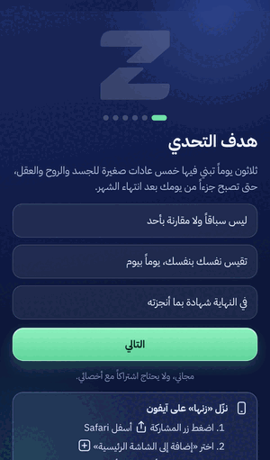 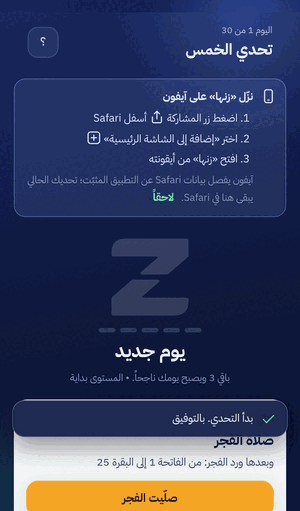 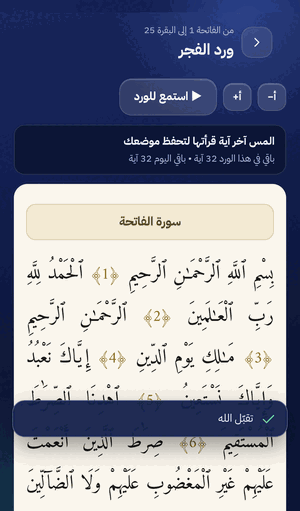

**بكلامها:**
«صاحبتي بعتت لي اللينك على واتساب. أول ما فتحته طلعت لي رسالة إني جوّه واتساب، ولازم أنسخ الرابط وأفتحه في Safari (`human_mona_whatsapp.png`). كويس إنهم نبّهوني، بس بصراحة نص الناس هيكمّلوا جوّه واتساب وخلاص.
الشرح خمس صفحات قصيرة، وفهمت منه الفكرة كلها: خمس حاجات كل يوم، و3 منهم يبقى يومي ناجح، ومفيش مقارنة بحد. جملة "بيانات عبادتك تبقى على جوالك فقط" ريّحتني جداً.
وأنا بكتب اسمي اتلخبطت شوية. فيه في نفس الصفحة مستوى ومدينة وماء، وتحتهم صندوق كبير بيقولي "نزّل زنها على آيفون… ثبّته أولاً ثم ابدأ من الأيقونة". طب أبدأ دلوقتي ولا أثبّت الأول؟ قررت أبدأ.
رمز الدخول أربع أرقام، سهل. بس تحته مكتوب "إن غيّرت جوالك يرسل لك أخصائيك رابطاً جديداً". أخصائي إيه؟ أنا ما عنديش أخصائي!
شاشة اليوم حلوة: كارت "التالي" فيه زرار واحد، "صلّيت الفجر". دوست عليه، فطلع لي "ورد الفجر: من الفاتحة 1 إلى البقرة 25". القارئ تحفة، والخط مصحف حقيقي، وفيه أ+ وأ−. لمست آخر آية قريتها وحفظ مكاني. ده أكتر حاجة عجبتني.
السبحة جميلة والحبّات بتنوّر واحدة واحدة. بس رسالة "تقبّل الله منك" فضلت على الشاشة وغطّت زرار السابق والتالي تحت السبحة (`human_mona_toast_sebha.png`)، واستنيت لحد ما اختفت.
آخر حاجة خضّتني: قفلت الصفحة ورجعت، ودوست "نسيت الرمز؟"، فقالي: "اطلب من أخصائيك رابط دعوة جديداً… خطتك تبقى محفوظة لدى أخصائيك" (`human_mona_forgot.png`). يعني لو نسيت الرمز هيضيع الشهر كله؟ وأي خطة؟ أنا ما عنديش خطة!»

- **فهمت:** فكرة التحدي، وإن 3 من 5 تكفي، وزرار "التالي"، وإن الورد يكمّل من حيث وقفت، والسبحة.
- **ترددت أو تاهت:** هل تثبّت التطبيق الأول ولا تبدأ على طول (صندوق التثبيت متكرر في الشرح وفي صفحة البداية وفوق شاشة اليوم). ونص الأخصائي في صفحة الرمز وفي "نسيت الرمز". ومش فاهمة شكل الـZ الرمادي الكبير في صفحة اليوم إيه (مذكور في الشرح بس كـ"قطعتا الشكل").
- **وثقت لأن:** الخصوصية واضحة، والنص من Tanzil و«حصن المسلم» ومكتوب مصدره، ومفيش نقاط ولا ترتيب على العبادة.
- **قلقت لأن:** نص "نسيت الرمز" بيوحي إن التحدي ممكن يضيع من غير ما يقولها ده صراحة، وكمان كلام عن أخصائي مش موجود.
- **هتقول لصاحبتها:** «جرّبيه، القارئ والسبحة حلوين أوي، بس افتحيه من Safari مش من واتساب، وما تنسيش الرمز.»
- **الدرجة: 7/10**
- **3 حاجات تخليها تكمّل:** (1) نص للضيف في صفحة الرمز و"نسيت الرمز" يقول الحقيقة من غير ذكر أخصائي. (2) قرار واحد واضح: "ثبّت الأول" أو "ابدأ هنا" من غير ما الاتنين يتكرروا في كل شاشة. (3) رسالة "تقبّل الله" ما تغطيش أزرار السبحة.

> ملاحظة المراجع: نص الضيف في الرمز موجود في صفحة إنشاء الرمز وفي نافذة "نسيت الرمز"، ويُعرض لمستخدم `S.guest` كما هو. الإشعار القصير (`toast`) يبقى 3.4 ثانية فوق شريط الأزرار السفلي في السبحة والأذكار.

---

## 2) خالد، 41 سنة، الرياض — أرسل له أخصائيه رابط دعوة

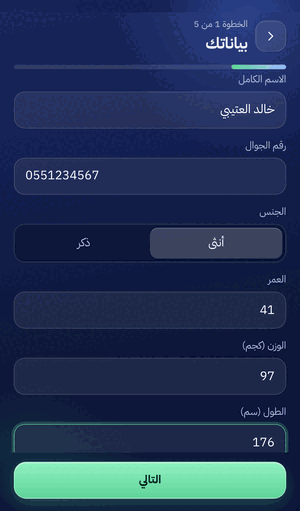 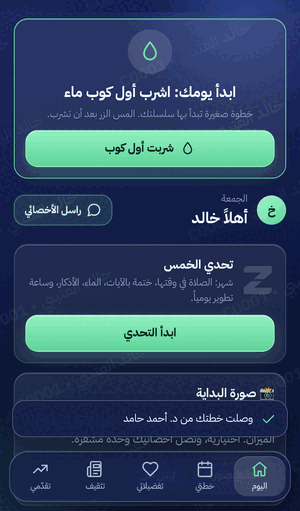 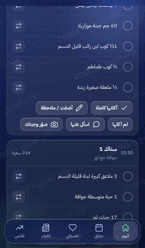 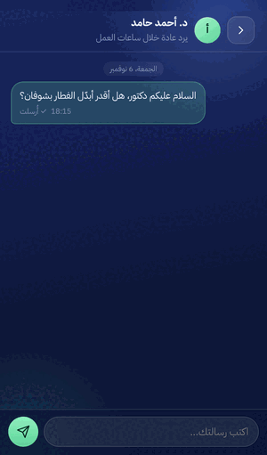

**بكلامه:**
«الدكتور أحمد أرسل لي رابط. أول ما فتحته طلعت ثلاث شاشات تعريف، فيها صحن ألمسه وكوب أعبيه. حلوة بس طويلة شوي، وبعدها سألني عن الشكل اللي يريحني. بعدها شفت اسم الدكتور وصورته الرمزية، وهذا طمّني إن الرابط فعلاً منه.
التسجيل خمس خطوات. في الخطوة الأولى، **الجنس كان مختار من أول ما فتحت الصفحة على "أنثى"**، وكنت بأكمل بدون ما أنتبه. وفي الهدف فيه خياران كل واحد اسمه "زيادة" بدون أي فرق بينهم. الخطوة الثالثة فيها 35 وجبة فطور لحالها، طويلة. والخطوة الرابعة: "المس مرة إن كنت تحبه ومرتين إن كنت لا تحبه"، احتجت أقرأها مرتين عشان أفهم.
بعد ما أرسلت قال "وصل طلبك إلى أخصائيك، عادة خلال يوم عمل". واضح ومريح.
لما وصلت الخطة: أول كرت "اشرب أول كوب ماء"، ضغطته فنزل مطر قطرات و"بدأت سلسلتك: يوم 1 🔥". حسّيت بإنجاز. الوجبات واضحة وكل صنف بكميته، وزر "بدّل" يعطيني بدائل من نفس المجموعة (تفاح، برتقال، تمر…). ممتاز.
اللي ضايقني: اسمي ورقمي C0001 مكتوب بالمائل على الشاشة كلها كأنها علامة مائية. فهمت إنها حماية، بس شكلها يشوّش على الأكل. وتحت كل وجبة خمسة أزرار: "أكلتها كاملة، أضفت / ملاحظة، لم آكلها، اسأل عنها، صوّر وجبتك". كثيرة.
المراسلة سهلة، وفيها أسئلة جاهزة مثل "أريد تبديل وجبة". رسالتي وصلت للدكتور على طول.»

- **فهم:** الخطة، والتبديل، والماء، وإن الدكتور يتابع ويرد.
- **تردد:** الجنس المختار من البداية، و"زيادة" المكررة، وطريقة اللمس مرة أو مرتين، وطول قائمة الفطور، وكثرة الأزرار تحت كل وجبة، وزر "التسجيل هنا في Safari" مقابل "انسخ رمز الدعوة وثبّت أولاً".
- **وثق لأن:** اسم الدكتور يظهر قبل أي شيء، وفيه "مشفّرة إلى د. أحمد حامد"، والوقت المتوقع للرد مكتوب، والخطة فيها سعراتها ورقم إصدارها.
- **قلق من:** العلامة المائية باسمه، وبطاقة "صورة البداية (قبل)" في أول يوم.
- **يقول لصديقه:** «مرتب، والتبديل بلمسة شي ما شفته في غيره، بس انتبه وأنت تسجل.»
- **الدرجة: 8/10**
- **3 أشياء تخليه يكمّل:** (1) الجنس بدون اختيار مسبق، والهدف "زيادة +250 / +500" مثل ما يشوفه الأخصائي. (2) زرّان ظاهران فقط تحت الوجبة ("أكلتها" و"لم آكلها") والباقي في "المزيد". (3) علامة مائية أخف أو تظهر عند لقطة الشاشة فقط.

> ملاحظة المراجع: القيمة الافتراضية `sex: 'أنثى'` في `src/hissati/app.js:67`. ويظهر "زيادة | زيادة" في الخطوة الأولى من التسجيل. بطاقات أول يوم كلها فوق الوجبات: الكوب الأول، وتحدي الخمس، وصورة البداية، والمتوفر من الأكل، ولوحة 29%. فيضطر العميل للتمرير مرتين أو ثلاثاً قبل أن يصل إلى "وجباتي".

---

## 3) د. سارة، أخصائية تغذية جديدة — تفتح «حصة» لأول مرة على شاشة 1440px

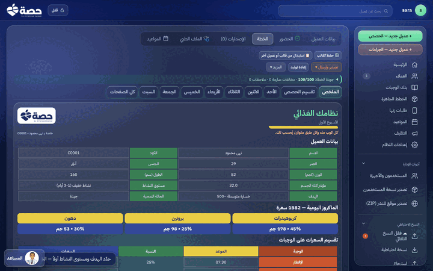 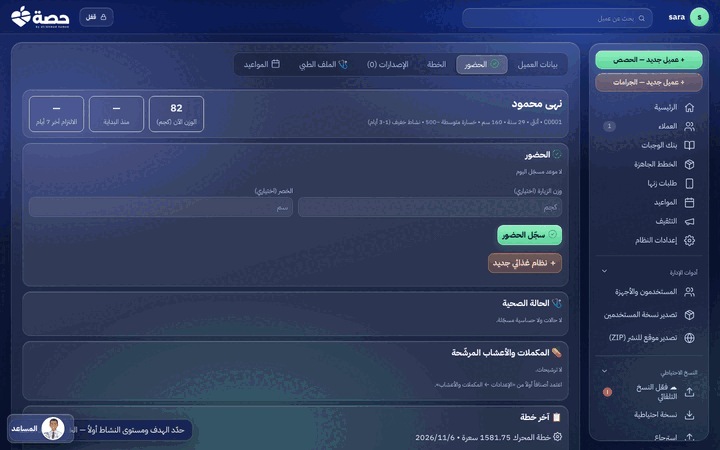 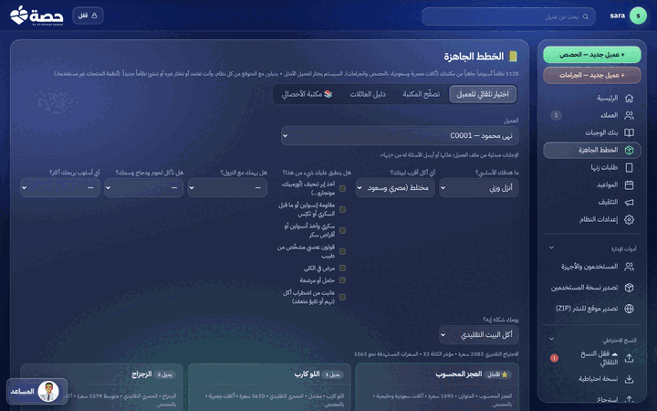

**بكلامها:**
«أول شاشة تطلب إنشاء حساب مدير، وفيها جملة "ضياع الكلمة أو المفتاح يعني إعادة إصدار كل الأكواد". خوّفتني شوية قبل ما أبدأ أصلاً.
الرئيسية مرتبة: بلاطات كبيرة و"من يحتاج اهتمامك اليوم". ضغطت "+ عميل جديد — الحصص" وكتبت البيانات. ولما ضغطت "ولّد خطة جديدة" قبل ما أختار الهدف قالت لي: "حدّد الهدف ومستوى النشاط أولاً — الخطة تُحسب منهما". ممتاز، ده بيحمي العميل. وعجبتني الجملة اللي بتشرح إن البروتين محسوب على الوزن المعدّل لأن BMI ≥ 30. دي بتبيّن إن اللي عامله فاهم.
الخطة اتولّدت في ثانية، وفيها "جودة الخطة: 100/100". الطباعة حلوة وألوانها واضحة.
**بس إزاي أبعتها للعميلة؟** دوّرت على "إرسال". لقيت "تصدير وإرسال ▾" وجواه Word وPDF وصفحة HTML بس. مفيش واتساب، ومفيش "ابعتي لزنها". فهمت بعدين إن الإرسال لزنها محتاج أدعي العميلة الأول من "زنها" في القائمة الجانبية، وبعدها يظهر تبويب جديد في ملفها. الطريقة دي مش باينة لحد جديد.
فقاعة "المساعد" تحت على الشمال فضلت تقول "حدّد الهدف ومستوى النشاط أولاً" حتى بعد ما الخطة اتولّدت. افتكرت إن فيه حاجة غلط.
تبويب "✅ الحضور" لقيته بسهولة، وفيه الوزن ووزن الزيارة والخصر وزر "سجّل الحضور". لكن آخر سطر بيقول "العميل غير مرتبط بزنها"، فحسّيت إن نصه فاضي من غير التطبيق.
"الخطط الجاهزة": 1128 نظام! ده كتير جداً، بس "اختيار تلقائي للعميل" بيسأل أسئلة بالعامية ("وزني ثابت ومش بينزل"، "آخذ إبر تنحيف")، ودي لمسة ذكية. اللي لخبطني الأسماء: "بنك الوجبات" و"الخطط الجاهزة" و"ولّد خطة من البنك". هل البنك هو الخطط الجاهزة ولا الوجبات؟»

- **فهمت:** إنشاء العميل، وإن الهدف والنشاط إجباريين، وتوليد الخطة، والطباعة، والحضور.
- **ترددت:** في الإرسال (أهم نقطة)، وفي أسماء "البنك/الجاهزة"، وفي فقاعة المساعد اللي فضلت قديمة، وفي عدد 1128.
- **وثقت لأن:** الحسابات ظاهرة (BMR وTDEE وBMI والماكروز)، ومكتوب سبب كل رقم، وفيه منع للتوليد من غير هدف، ودرجة جودة.
- **قلقت من:** "البيانات محفوظة داخل هذا المتصفح فقط" (صحيحة بس بتخوّف)، وتحذير ضياع المفتاح.
- **هتقول لزميلتها:** «بيوفّر ساعات في كتابة الأنظمة، بس اسأليني إزاي تبعتي للعميل.»
- **الدرجة: 7/10**
- **3 حاجات تخليها تكمّل:** (1) في "تصدير وإرسال" خيار "أرسل إلى زنها / ادعُ العميل" يوديها لخطوة الدعوة على طول. (2) اسم واحد واضح لـ"البنك" (مثلاً "الخطط الجاهزة" في كل مكان). (3) فقاعة المساعد تتحدّث أو تختفي بعد ما المشكلة تتحل.

---

## 4) أم عمر، 52 سنة، ضعيفة النظر وتكبّر الخط

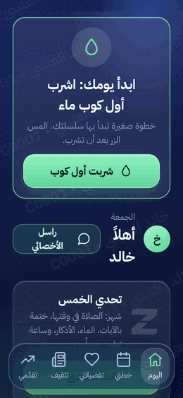 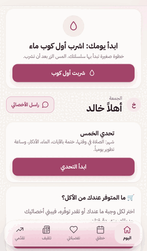 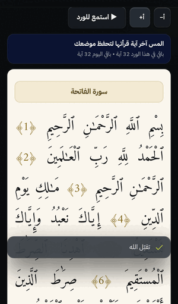

**بكلامها:**
«أنا مكبّرة الخط في الجوال. لما فتحت زنها كبر الكلام، وما فيه شي طلع برا الشاشة أو انقطع، والأزرار الخضراء كبيرة وواضحة. الحمد لله.
بس الكلام الصغير الرمادي، مثل أوقات الوجبات "07:30 • 535 سعرة" و"كوب = 250 مل • المس الكوب" و"سعرة هدفك"، صعب أقراه حتى بعد التكبير. لونه رمادي فاتح على كحلي.
الشكل الغامق تعّب عيني، فبدّلت من "تقدّمي" إلى ثيم "وردة"، وصار الخلفية فاتحة والكلام غامق. أريح بكثير. يا ليتهم سألوني في البداية بصراحة: "تحبين الخط أكبر؟ تحبين الخلفية فاتحة؟". صحيح إنه سألني "اختر الشكل الذي يريحك"، بس ما فهمت إنها عشان النظر.
في القرآن ضغطت أ+ ثلاث مرات وصار الخط كبير وجميل. ليت هالزر موجود في الأكل والأذكار كمان.
شريط الأيام فوق الخطة (أحد، اثنين، ثلاثاء…) ينقص من الطرف وأنا ما أعرف إنه يتحرك، والأسئلة الجاهزة في الرسائل نفس الشي. وتحت كل وجبة أزرار كثيرة وصغيرة، أخاف أضغط "لم آكلها" وأنا أبي "أكلتها".»

- **فهمت:** الأزرار الكبيرة، والماء، والقرآن مع التكبير.
- **ترددت:** الشرائط اللي تتحرك يمين ويسار ما لها علامة، والأزرار المتقاربة تحت الوجبة، ومكان تغيير الشكل (مدفون في "تقدّمي").
- **وثقت لأن:** ولا شي انكسر مع التكبير، والقرآن واضح جداً.
- **ما ارتاحت لـ:** الخط 11–12px الرمادي، والعلامة المائية فوق الكلام (تخلّيه أصعب في القراءة).
- **تقول لجارتها:** «زين، بس بدّلي الشكل إلى "وردة" من أول يوم.»
- **الدرجة: 6/10**
- **3 أشياء تخليها تكمّل:** (1) إعداد "حجم الخط" للتطبيق كله (أ+ / أ−) مثل اللي في القرآن. (2) لا خط أصغر من 14px للأوقات والسعرات، وتباين أعلى للنص الرمادي. (3) سؤال صريح في التعريف: "هل تفضّلين الخلفية الفاتحة والخط الكبير؟".

> ملاحظة المراجع: قسنا أحجام الخط في شاشة "اليوم" بالثيم الافتراضي، فكان فيها 8 عناصر بحجم 11px و16 بحجم 12px، ولونها `rgb(135,148,184)` أو `rgb(180,193,226)` على كحلي. التباين يتجاوز AA عددياً، لكن الحجم صغير. لا يوجد في التطبيق إعداد عام لحجم الخط، وأزرار `khFs` (أ+ / أ−) موجودة في قارئ القرآن فقط. لم يظهر أي فيض أفقي عند عرض 260px (`docW = 260`).

---

## مقارنة سريعة

| الشخصية | الدرجة | أكثر ما أحبّته | أكثر ما أقلقها |
|---|---|---|---|
| منى (تحدي، ضيفة) | 7 | القارئ ونقطة التوقف والسبحة | "نسيت الرمز" يتكلم عن أخصائي، والخوف من ضياع التحدي |
| خالد (عميل مرتبط) | 8 | اسم الأخصائي أولاً، والتبديل بلمسة، والرد السريع | الجنس مختار مسبقاً على "أنثى"، والعلامة المائية |
| د. سارة (أخصائية) | 7 | الحسابات الظاهرة، ومنع التوليد بلا هدف | لا تعرف كيف ترسل الخطة للعميل |
| أم عمر (خط كبير) | 6 | لا شيء ينكسر، والقرآن المكبّر | النص الصغير الرمادي، ولا إعداد عاماً لحجم الخط |

## نقاط الألم مرتّبة بعدد الشخصيات التي واجهتها

| # | المشكلة | من واجهها | العدد |
|---|---|---|---|
| 1 | **إشعارات وفقاعات تغطي المحتوى أو تبقى قديمة:** "تقبّل الله منك" فوق أزرار السبحة والأذكار، و"وصلت خطتك" فوق الوجبات، وفقاعة المساعد في «حصة» تبقى بعد حل المشكلة | منى، خالد، سارة، أم عمر | 4 |
| 2 | **ازدحام الشاشة الأولى:** صندوق التثبيت يتكرر، ثم 4 إلى 5 بطاقات قبل المحتوى الأساسي (الوجبات أو التالي)، وأزرار كثيرة تحت كل وجبة | منى، خالد، أم عمر | 3 |
| 3 | **نصوص لا تناسب من يقرؤها:** نص الأخصائي يظهر للضيف (صفحة الرمز و"نسيت الرمز")، و"زيادة" مكررة، والجنس مختار مسبقاً على "أنثى" | منى، خالد | 2 |
| 4 | **حيرة التثبيت على آيفون أو المتابعة في Safari** (نسخ رمز النقل، وفصل بيانات Safari عن التطبيق المثبّت)، وفتح الرابط من داخل واتساب | منى، خالد | 2 |
| 5 | **العلامة المائية باسم العميل** فوق النص تشوّش القراءة وتقلق العميل | خالد، أم عمر | 2 |
| 6 | **مقروئية النص الصغير** (11–12px رمادي)، ولا يوجد إعداد عام لحجم الخط، وتغيير الشكل مخفي في "تقدّمي" | أم عمر (وخالد لاحظ صغر أزرار الوجبة) | 2 |
| 7 | **شرائط أفقية بلا علامة تمرير** (أيام الخطة، والأسئلة الجاهزة في الرسائل) | أم عمر | 1 |
| 8 | **إرسال الخطة غير ظاهر في «حصة»:** "تصدير وإرسال" فيه ملفات فقط، والإرسال إلى «زنها» يحتاج دعوة من مكان آخر | سارة | 1 |
| 9 | **أسماء متداخلة:** "بنك الوجبات" و"الخطط الجاهزة" و"ولّد خطة من البنك"، و1128 نظاماً بلا تمهيد | سارة | 1 |
| 10 | **رسائل تخويف في البداية:** "ضياع المفتاح يعني إعادة إصدار كل الأكواد"، و"محفوظة في هذا المتصفح فقط"، و"لا يمكن استرجاع الرمز" | سارة، منى | 2 |

**ما وثق به الجميع:** وضوح الخصوصية والتشفير، وذكر المصادر (Tanzil، و«حصن المسلم»، واسم الأخصائي)، وأن البيانات لا تتحرك إلا بفعل المستخدم، وأنه لم يتعطل شيء ولم يظهر خطأ في أي جولة.

**أهم 3 إصلاحات (تتطلب قراراً من المالك في الصياغة فقط، ولا تمس السريري):**
1. نصوص الضيف في الرمز و"نسيت الرمز"، وإلغاء الجنس المختار مسبقاً، وكتابة "زيادة +250 / +500" للعميل.
2. منع الإشعار القصير من تغطية شريط الأزرار السفلي، وتحديث فقاعة المساعد في «حصة» أو إخفاؤها بعد حل المشكلة.
3. إعداد عام لحجم الخط في «زنها»، ورفع أصغر خط إلى 13–14px، وخيار "أرسل إلى زنها" داخل "تصدير وإرسال" في «حصة».
